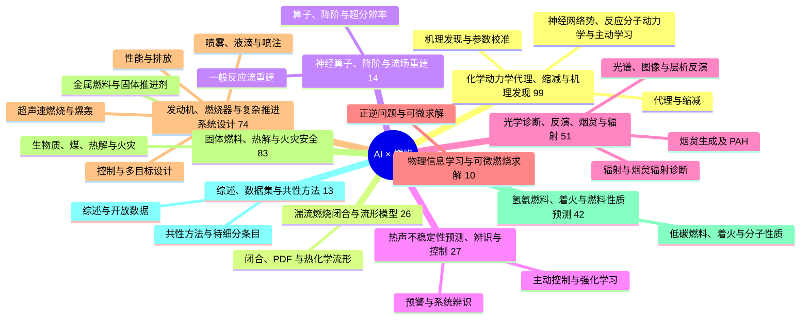

# 燃烧 AI 文献思维导图与研究导航

这张图按物理问题组织，方法横跨分支。它概括本轮检索到的研究版图，不能解释为已经穷尽或全文核实的所有 Q1/Q2 文章。分区采用 JCR 线索，官方版本仍待核实。

## 怎样读这张图

燃烧 AI 常见的目标可以分成四类：替代昂贵计算、从观测恢复状态、从数据发现/校准规律、进行预测与控制。先选目标，再选网络；相同 PINN、CNN 或 Transformer 在不同物理任务上的可比性通常有限。

1. 入门先阅读综述与 B01/B02，理解数据、单位、切分和指标。
2. 若关注 CFD 成本，沿化学代理 → 湍流闭合 → 神经算子阅读。
3. 若关注实验，沿光谱/层析 → 不稳定性辨识 → 控制阅读。
4. 若关注新燃料与安全，沿燃料性质 → 氢氨着火 → 热解/热失控与不确定度阅读。

## 全量与专题入口

- [逐方向全部论文](ALL_PAPERS.md)：含待核实状态；Q3/Q4 单独附录。
- [2024–2026 年新文献](RECENT_2024_2026.md)：按方向组织，保留 DOI 与论文卡。
- [方法×问题×数据矩阵](METHOD_PROBLEM_MATRIX.md)：理解任务与评价，避免只按模型名字追热点。
- [代码优先阅读路线](CODE_READING_ROUTE.md)：目前已核对论文—代码的工作。
- [详细研究路线与思维导图](RESEARCH_ROADMAP.md)：物理问题、模型层级、源码和评价设计。
- [逐篇开源可用性](OPEN_WORK_INDEX.md)：入口、依赖、数据和缺失项。
- [研究问题与证据缺口](RESEARCH_QUESTIONS.md)：可验证的研究设计，不把检索未见说成全球空白。
- [JCR 类别证据](JCR_EVIDENCE.md)：解释多类别分区、二级来源和待核实条目。
- [本地交互检索](explorer.html)：搜索题名/作者/DOI，筛选年份、方向、分区和代码。

## 分支详解

- [化学动力学代理、缩减与机理发现](branches/01_chemistry_kinetics.md)：把每个网格里昂贵的化学计算变快，同时尽量保留点火、放热和污染物的正确性。
- [湍流燃烧闭合与流形模型](branches/02_turbulence_closure.md)：大涡模拟看不清所有小火焰结构，需要模型补上未解析尺度对反应和混合的影响。
- [神经算子、降阶与流场重建](branches/03_operators_reconstruction.md)：从少量状态、低分辨率场或参数，预测完整流场及其演化，减少重复高保真模拟。
- [热声不稳定性预测、辨识与控制](branches/04_instability_control.md)：识别火焰放热与声波之间的正反馈，在振荡扩大前预警或采取控制。
- [光学诊断、反演、烟炱与辐射](branches/05_diagnostics_radiation.md)：让光谱和图像提供更可靠的温度、组分和三维场信息，并加速参与性介质辐射计算。
- [物理信息学习与可微燃烧求解](branches/06_physics_informed.md)：把守恒方程和边界条件加入模型，使稀疏数据下的正问题和逆问题更有物理约束。
- [发动机、燃烧器与复杂推进系统设计](branches/07_engineering_design.md)：用代理、优化和控制在效率、排放、稳定性和成本之间寻找可用工况。
- [固体燃料、热解与火灾安全](branches/08_solid_fuels_fire.md)：从热分析到火焰图像，研究固体如何分解、着火、放热，以及怎样预测火灾风险。
- [氢氨燃料、着火与燃料性质预测](branches/09_fuels_properties.md)：从分子结构或工况预测着火、火焰速度和燃料性质，为低碳燃料选择提供依据。
- [综述、数据集与共性方法](branches/10_reviews_methods.md)：先建立全局坐标，再沿具体物理问题阅读；数据和评价协议同模型一样重要。
