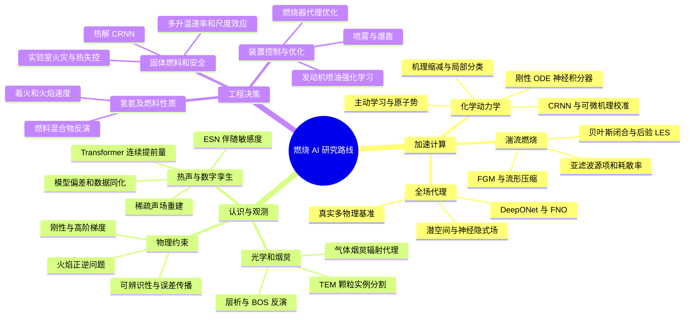

# 燃烧 AI 的研究路线：从物理问题到可用开源工作

更新：2026-11-12。今天优先扩充文献、代码和使用说明；训练与正式复现留待服务器接入后开展。至少 100 篇 Q1 的复现目标继续保留，但不以收录数量替代复现数量。以下是本库基于现有证据设计的路线，不是所有论文已经达成的结论。

[全部论文](ALL_PAPERS.md) · [逐篇开源工作与状态](OPEN_WORK_INDEX.md) · [固定版本代码包](../code_packages/README.md) · [分区证据](JCR_EVIDENCE.md)

## 先理解研究在替代什么

燃烧数值计算昂贵，通常有三个不同来源：每个网格的化学反应非常刚性；湍流与火焰同时跨越很多尺度；复杂工况需要重复计算。相应地，化学积分代理、湍流闭合和流场算子解决的是不同层级的问题。一个模型在单步化学预测上很准确，并不能证明完整燃烧流场长期稳定。

实验侧还有另外三个目标：把图像、光谱或少量传感器变成物理量；提前识别失稳；用有限实验校准或优化模型。这些任务需要观测噪声、仪器标定、工况留出和不确定度评价。只把网络换成最新架构，通常不足以构成有说服力的研究贡献。

## 路线一：化学计算 → 湍流闭合 → 后验反应流

**第一层，学习化学时间推进。** 以 [DFODE-kit](../code_packages/deepflame-ai__DFODE-kit/README.md)、[SL-GPS](../code_packages/ctftamu__SL-GPS/README.md) 和 [CMLM](../code_packages/NatLabRockies__cmlm/README.md) 对照阅读。先明确网络预测的是下一时刻状态、反应源项还是点火指标。随后检查采样覆盖、Box–Cox 等变量变换、元素守恒、负组分与回退策略。训练/测试按整条反应轨迹划分。

**第二层，让反应流模型使用这些结果。** 从 [DeepFlame](../code_packages/deepflameCFD__deepflame-dev/README.md) 查看网络部署与传统求解器接口，从 [ai_reacting_flows](../code_packages/cmehl__ai_reacting_flows/README.md) 查看数据库、混合和训练管线。单步测试后再比较一维火焰，最后考虑 LES。每一步都记录化学误差、CFD 全部耗时和模型失败条件。

**另一条分支是空间缩减，而非时间替代。** [adaptiveChemistry](../code_packages/gdalessi__adaptiveChemistry/README.md)、[OpenMORe](../code_packages/gdalessi__OpenMORe/README.md) 与 [ORCh](../code_packages/beroudiauxa__ORCh_2023/README.md) 帮助理解局部机理、聚类、在线分类及神经缩减。需要把分类错误与缩减误差分开评价。

**第三层，处理未解析尺度。** 阅读 [条件耗散率模型](../code_packages/cristianlacey__data-based-dissipation-rates/README.md)、[多模态耗散率模型](../code_packages/cristianlacey__data-based-multi-modal-filtered-dissipation-rates/README.md) 与 [贝叶斯闭合](../code_packages/NatLabRockies__mluq-prop/README.md)。优先比较跨滤波尺度、跨燃烧模态和不确定度校准。低离线误差之后，还需后验耦合检验。

## 路线二：物理约束 → 算子学习 → 复杂场景

[FlamePINN-1D](../code_packages/CAME-THU__FlamePINN-1D/README.md) 适合建立守恒、边界条件、尺度与逆参数的概念；[已完成的单工况记录](../reproductions/C02_flamepinn_case1/README.md) 保留了实际误差和与原文的差异。PINN 的重点是问题约束和优化行为，不能用训练损失代替物理误差。

[扩展 DeepONet](../code_packages/somdattagoswami__Approximating-StiffKinetics/README.md) 将目标转向一组输入函数/初值对应的一组解。上游只公开有限 Example 3 数据，先补数据生成协议；算子跨初值泛化与单条轨迹插值必须区分。

[REALM](../code_packages/deepflame-ai__REALM/README.md) 把 FNO、Transformer、图/网格网络等放到更真实的反应流、爆轰和推进场景。先从小型单案例建立同口径评价，再扩大问题；README 的约 15 TB 数据规模不适合直接全量下载。此处保留预印本身份，未赋 JCR。

KAN、输出缩放层、图网络和生成模型可作为有针对性的比较方案。应先提出要解决的刚性、非均匀网格、长时误差或数据稀缺问题，再选择架构。[GBCT](../code_packages/Seauagain__GBCT/README.md) 与 [ChemKAN](../code_packages/DENG-MIT__ChemKAN/README.md) 的数据、权重和版本证据仍需补齐。

## 路线三：测量 → 状态估计 → 预警和控制

**先重建状态。** [HCTA](../code_packages/MagriLab__HCTA/README.md) 从压力测点推断声压和速度，包含 Rijke 管及更高保真数据入口。先问未测速度是否可辨识，再看噪声、测点数和时间外推。不能把合成孪生实验直接等同真实燃烧室验证。

**再修正模型。** [Real-time-TA-DA](../code_packages/MagriLab__Real-time-TA-DA/README.md)、[rBA-EnKF](../code_packages/MagriLab__rBA-EnKF/README.md) 和 [数字孪生维护版](../code_packages/andreanovoa__real-time-bias-aware-DA/README.md) 分别对应历史 MATLAB 实验、带勘误的方法和后续 Python 重构。复现时必须选定与论文对应的版本，不能混用新旧默认值。

**随后预测失稳时间。** [连续提前量 Transformer/LSTM/XGBoost](../code_packages/Predictive-Intelligent-Systems-Lab__TTE-TAI-PROCI-paper/README.md) 提供合成轨迹生成、起振标签与实验评价入口。按整次实验爬升留出；重点是预警距离、误报/漏报与跨工况表现，而不是重叠滑窗的随机测试精度。

**最后进入设计和控制。** [Adjoint-ESN](../code_packages/MagriLab__Adjoint-ESN/README.md) 估计目标函数梯度，[多保真 GP](../code_packages/ShuaiGuo16__Multi-Fidelity-ML/README.md) 辨识火焰频率响应，[发动机喷油 PPO](../code_packages/NatLabRockies__MPRL/README.md) 研究控制决策。模型梯度可信度、约束违反与真实决策成本应分别报告；后者当前二级分区为 Q3，留在附录。

## 路线四：图像和光谱 → 物理诊断

[SAGE](../code_packages/comp-comb__SAGE/README.md) 针对烟炱 TEM 颗粒实例分割，包含训练和分析 notebook、权重下载入口。既要看分割指标，也要看颗粒尺度分布、重叠颗粒和跨样本来源的系统偏差。

[气体–烟炱 FSCK](../code_packages/ZY-LHY__Machine_learning_based_FSCK_model_soot/README.md) 与 [氨燃烧 PINN-WSGG](../code_packages/TaoRen-Rad__WSGG-H2O-CO2-NH3/README.md) 解决辐射计算的紧凑表示。先统一光谱/热流真值和物理单位，再比较误差与成本；气体种类、温度与烟炱浓度外推需单独验证。

[NN4Soot](../code_packages/cfx18__NN4Soot/README.md) 面向烟炱动力学敏感度与拟合，其 README 仍写 under review，但 Crossref 已有同题期刊记录。当前只认题名关联，且未定位 LICENSE 文件，不能照 README 的 MIT 声明直接镜像。

## 氢氨、热解和复杂燃料怎么接入

氢氨不是一个网络类别，而是贯穿化学、湍流、辐射和控制的燃料对象。不同研究应分别核对差异扩散、机理、NOx 与测量不确定度。[氢燃烧主动学习](../code_packages/THGLab__H2Combustion_AL/README.md) 走原子势和分子动力学路径，需要额外量子化学数据与计算预算；不宜与宏观 CFD 代理混在一个榜单。

热解/固体燃料沿 [Biomass.jl](../code_packages/DENG-MIT__Biomass.jl/README.md) 和 CRNN 阅读，注意多升温速率、材料批次、气氛与可辨识性。相邻热转化文章需说明与燃烧研究的联系。全球野火、遥感火点及灾情/气候预测已排除；保留实验室火焰、建筑火灾和反应机理研究。

## 下一阶段的具体产物

| 阶段 | 先做什么 | 可审阅产物 | 推进条件 |
|---|---|---|---|
| 当前收录阶段 | DOI 去重、研究方向分类、固定源码版本、许可与数据入口检查 | 逐篇 README、源码包/链接、缺失项和本路线图 | 不要求训练成功 |
| 服务器准备阶段 | 获取 GPU/显存/驱动信息；按论文配置独立环境；核对机理、数据及权重 | 环境锁定、数据清单与哈希、最小案例命令 | 数据/依赖具备，原文目标明确 |
| 正式复现阶段 | 选原文图表，按同切分和指标执行，保存所有运行与偏差 | 原文值/本地值对照、日志、图表与失败分析 | 完整证据满足后才计入 Q1 复现目标 |

并行方向的优先顺序取决于数据与协议完备性。HCTA、FSCK、DFODE 和连续热声预警具有较清晰入口；数据申请、缺许可、历史编译环境或未发表身份的工作继续保留待办。JCR 版本和类别仍需权威来源核实，不因找到代码而自动成为已确认 Q1。
