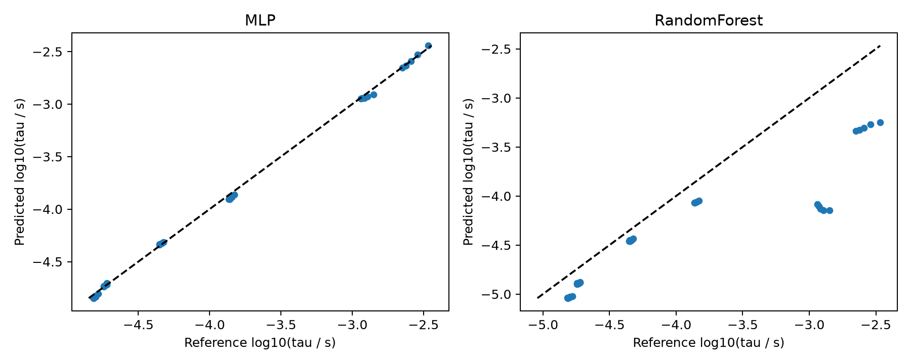

# B01：H2/air 点火延迟代理基线

**已实际执行的独立基线，不是特定论文原始指标复现。** 目的：提供从物理求解生成数据、按工况留出、训练、误差输出到机制溯源的最小完整链路。

## 物理问题与数据

Cantera 内置 `h2o2.yaml`；封闭、绝热、理想气体、定容反应器。空气为 O2:N2 = 1:3.76（摩尔比）。温度 950、1000、1050、1100、1150、1200、1250、1300 K；压力 1/3/5 atm；当量比 0.5/0.75/1/1.25/1.5，共 120 工况。

点火延迟定义为首次 T = T0 + 400 K 的时间，在求解器接受步之间线性插值。容差 rtol=1e-9、atol=1e-15；搜索上限约 0.2 s，步进可能越过上限一个接受步。本次 120 例均在上限内点火，没有删失样本。若扩展范围出现未点火，应改用严格截止并正确处理右删失，不能直接丢弃后再报告总体性能。

## 切分与模型

完整留出 1050 K 与 1200 K 的全部压力/当量比组合：训练 90、测试 30。属于温度**插值**测试，压力与当量比取值已在训练集出现。不是跨燃料、跨机理、跨压力的外推验证。

输入为 1000/T、ln(p/atm)、phi，目标为 log10(tau/s)。MLP 的 StandardScaler 只用训练集拟合；MLP 为 32×32 tanh、LBFGS、alpha=1e-3、max_iter=3000；RF 为 200 棵树。随机种子均为 42，超参数未基于测试误差搜索。

## 执行

在仓库根目录运行，建议使用独立虚拟环境：

```powershell
python -m pip install -r requirements-baselines.txt
python reproductions/B01_hydrogen_ignition/run.py
```

## 本次结果

| 模型 | log10 MAE | log10 R2 | 中位相对误差 |
|---|---:|---:|---:|
| MLP | 0.0223832 | 0.999035 | 4.1174% |
| RandomForest | 0.441935 | 0.517342 | 39.8236% |

相对误差为 abs(pred/ref - 1)，不是对数误差。以上结果来自一次固定种子运行；RF 在这个稀疏温度插值问题上较差，不能推广成所有燃烧任务中 RF 都较差。



原始数据：[dataset.csv](results/dataset.csv)；逐样本预测：[predictions.csv](results/predictions.csv)；环境、机制与数据哈希：[metrics.json](results/metrics.json)。记录的约 1.55 s 是本次脚本总墙钟时间，不是相对详细化学的加速倍数。

## 公式—代码映射与局限

- 物理参考：`ignition()` 中 IdealGasReactor + ReactorNet。
- 点火定义：`threshold = temperature + 400` 与接受步插值。
- 输入、标签与切分：`main()` 中 features、targets、test_mask。
- 模型与指标：训练循环和 models 字段。

没有实验数据验证，没有多随机种子统计，没有机理误差量化，也没有比较训练成本摊销。适合教学和工具链验收，不应作为发表级性能结论。下一步增加未见温压区域、近点火极限和多个机理，并预先设计删失处理及基线。
