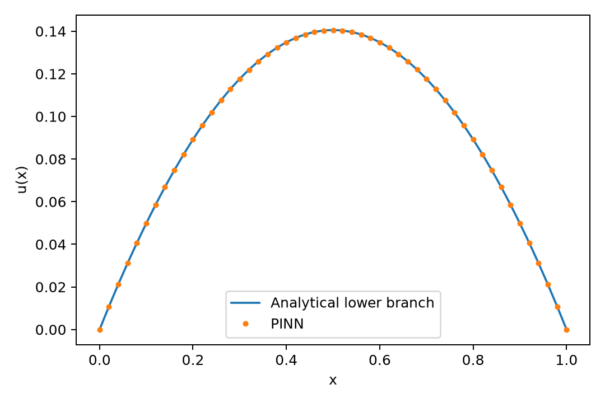

# B02：Bratu 方程 PINN 独立基准

**已实际执行的方程基准，不是 Fuel 论文实验复现。** 与固体生物燃料燃烧理论中的稳态热反应模型有关；真实火焰还需化学、流动和输运。

## 方程与解析参考

求解 u'' + lambda exp(u) = 0，x ∈ [0,1]，u(0)=u(1)=0，本例 lambda=1。解析解取

u(x) = -2 ln[cosh(theta(x-1/2)) / cosh(theta/2)]，其中 2 theta² / cosh²(theta/2) = lambda。

用 Brent 法在 theta ∈ (0.01,2) 求下分支，得到 theta≈0.7585823。Bratu 在部分参数区间有双解；本例只验证下分支，没有证明网络能追踪临界点或上分支。

## 实现映射

| 数学对象 | 代码 |
|---|---|
| u=x(1-x)N(x)，精确满足边界 | prediction() |
| 一、二阶导数 | torch.autograd.grad 两次 |
| 方程残差均方 | loss() |
| 解析分支参数 | scipy.optimize.brentq |
| 独立密网格验证 | 501 个点与解析解比较 |

网络 1–24–24–1、tanh、float64，100 个等距残差训练点；Adam 1500 步，之后 LBFGS 最多 300 次；seed=42；CPU 单线程。验证网格不是只看训练残差，但包含部分与训练网格重合的点。

## 运行与结果

```powershell
python -m pip install -r requirements-baselines.txt
python reproductions/B02_bratu_pinn/run.py
```

| 指标 | 本次实测 |
|---|---:|
| 最大绝对误差 | 2.52079e-6 |
| 相对 L2 | 1.40155e-5 |
| 训练点残差 MSE | 7.11375e-8 |
| 边界最大误差 | 0 |



[完整数值和环境](results/metrics.json) · [密网格解](results/solution.csv) · [Adam 训练历史](results/training_history.json)。记录的约 4.82 s 仅为本次环境下脚本时间；没有与有限差分或原论文作公平耗时比较。

相关文献入口：[Fuel, 10.1016/j.fuel.2022.125908](https://doi.org/10.1016/j.fuel.2022.125908)。本例自行选择了网络、训练点和优化器，不声称复现该文图表。下一步应做多种子、lambda 参数扫描、有限差分对照以及分支识别，并记录未收敛情况。
