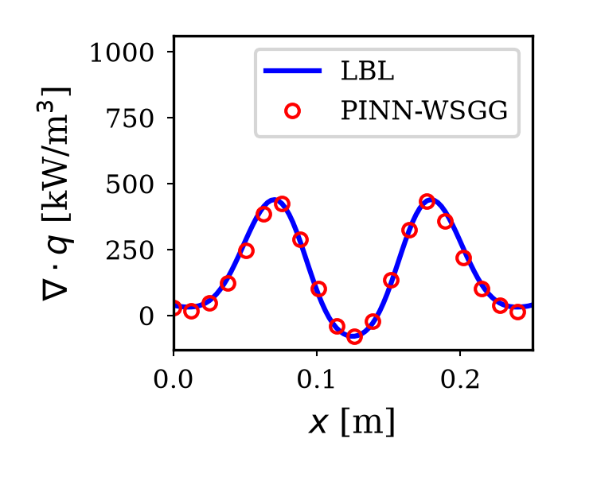

# C01：PINN-WSGG 作者演示执行与数值核验

关联论文：[Physics-informed neural network WSGG model for radiative heat transfer in H2O–CO2–NH3 gas mixtures relevant to ammonia combustion](https://doi.org/10.1016/j.proci.2026.106476)，Proceedings of the Combustion Institute，2026。

**状态：作者固定版本推理演示已执行；未复现原始训练或核对原文目标表格。** 使用作者提供的剖面、预训练 JSON 权重和 LBL 参考数值，未独立重算 LBL。

## 来源和执行

- 仓库：TaoRen-Rad/WSGG-H2O-CO2-NH3。
- 固定提交：`0ed02920a2ea9dbea0c60db02fd51b4695cf6260`；MIT 许可保留在代码包卡中。
- 原始入口：`test.py`，CPU float32，读取 100 点的空间剖面和两侧 300 K 边界。
- 本库适配：Agg 无窗口制图、关闭外部 LaTeX 渲染、CPU 单线程；未修改数值源代码、权重或输入数据。
- 在原始演示之外，再调用相同上游函数导出全量数值和误差。

```powershell
python -m pip install -r requirements-baselines.txt
python tools/fetch_packages.py --package TaoRen-Rad__WSGG-H2O-CO2-NH3
python reproductions/C01_wsgg_author_demo/run.py
```

脚本先校验归档 SHA-256，再检查解压路径与符号链接，在忽略的 vendor 目录解压。完整来源、环境、输入哈希见 [metrics.json](results/metrics.json)。该命令会执行已检查的上游 Python 代码。

## 本次实测

| 指标 | 数值 |
|---|---:|
| 参考点数 | 100 |
| 辐射源项 MAE | 15268.50 W/m³ |
| MAE / 参考源项极差 | 0.0294764（2.94764%） |
| 相对 L2 | 0.0810687（8.10687%） |
| 最大绝对误差 | 43116.58 W/m³ |

MAE/极差与逐点相对误差不同：分母为 max(reference)-min(reference)。相对 L2 的分母为参考向量 L2 范数。不能把“2.95%”不加定义地说成所有辐射误差。



[逐点预测与参考](results/predictions.csv)包含 x、LBL 源项、PINN-WSGG 源项、热流和入射辐射。脚本本次数值/制图耗时约 1.07 s，不是模型相对 LBL 的加速比。

## 公式与实现对应

- `NN_WSGG.forward`：softmax 给出 5 个灰气权重，exp 给出非透明分量吸收系数。
- `nn_wsgg_rte`：读取温度与混合气摩尔分数，逐灰气调用一维 RTE。
- `solve_rte`：光学厚度积分，计算入射辐射 G、热流 q 和源项。
- 本库 `run.py`：与上游 `results.npy` 最后一列逐点比较，导出实测数值。

## 局限和下一步

只有作者提供的单一演示剖面，不能证明未知配比、压力、光学厚度或三维耦合泛化。下一步应阅读原文确定训练和验证域，独立生成 LBL 参考，按原文指标复现指定图表，并检验近零源项、边界和积分能量误差。
