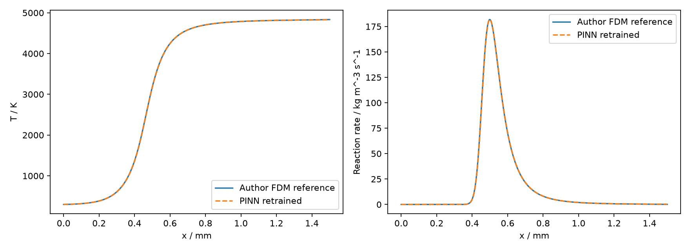

# C02｜FlamePINN-1D：已完成的单工况训练记录

2026-11-12，CPU，seed=42。训练在用户要求优先收录之前已完成；本轮只修正结果解析与整理文档，没有新增训练。这是**预印本一个子算例的对照**，不计为完整期刊论文或严格 Q1 复现。

- 期刊 DOI：[10.1016/j.combustflame.2025.113964](https://doi.org/10.1016/j.combustflame.2025.113964)。
- 实际核对版本：[arXiv:2406.09071v1](https://arxiv.org/abs/2406.09071v1)，Section 3.1.1、Figure 3 第一工况、Table 3；最终发表版一致性待核。
- [作者源码与许可](../../code_packages/CAME-THU__FlamePINN-1D/README.md)；提交 `f7c0c0c3dc9b75d41d0bb090d265650a67999c45`。
- [输入来源与哈希](results/inputs.json) · [指标](results/metrics.json) · [原始日志](results/training.log)。

## 物理与训练协议

一维自由传播简化预混火焰：在 1 atm、入口 298 K、当量比 0.4 下学习温度分布并推断火焰速度，进一步得到燃料质量分数、速度、密度、反应速率及压力相关量。

| 项目 | 本次设置 |
|---|---|
| 网络 | 1–64–64–64–1，tanh，沿用上游温度输出变换 |
| 精度 / 设备 | float64 / CPU，2 线程 |
| 预训练 | Z 型曲线预热 1000 步 |
| PDE 训练 | Adam 30000 步，初始学习率 0.001，按原实现阶梯衰减 |
| 域内点 / 评价点 | 1001 个固定均匀点 / 5001 个均匀点；另含边界样本 |
| 边界 | 温度及梯度软约束 |
| 火焰速度初始值 | 0.4 m/s |
| 参考解 | 作者一阶有限差分/二分法结果，10000 网格点；未独立重算 |

源码默认 Hammersley 采样，Table 3 写均匀采样；源码硬编码工况也不同于目标工况。run.py 用 AST 加载上游主函数，避开硬编码命令行段，显式配置 phi=0.4 与均匀采样。方程、网络和损失实现沿用作者代码。单一随机种子是显式选择，原文未提供可核对种子。

## 实际结果

相对 L2 为 `sqrt(sum((prediction-reference)^2)/sum(reference^2))`；表中百分数为比值乘以 100。

| 量 | 预印本该工况 | 本次计算 |
|---|---:|---:|
| 温度相对 L2 | 0.13% | 0.14881% |
| 反应速率相对 L2 | 1.08% | 1.23671% |
| 燃料质量分数相对 L2 | 未摘录单工况值 | 0.24296% |
| 速度相对 L2 | 同上 | 0.15638% |
| 密度相对 L2 | 同上 | 0.26359% |
| 压力相关量相对 L2 | 同上 | 0.18548% |
| 火焰速度相对误差 | 12 工况最大绝对值 0.03% | −0.0179%，仅此工况 |

温度与反应速率误差分别比报告值高约 0.01881、0.15671 个百分点。压力沿上游字段定义，不能解释为绝对腔压。火焰速度约为参考 0.26794 m/s、推断 0.26789 m/s；相对误差取上游四舍五入摘要。最优保存 epoch 为 29900；两阶段上游计时 1.07 s 和 220.43 s，不含安装/下载。



[predictions.csv](results/seed42/predictions.csv) 有 5001 行参考/预测；[上游指标](results/seed42/metrics.txt)、[损失历史](results/seed42/losses_history.csv)、[参数历史](results/seed42/parameters_history.csv) 保留过程证据。全部数值来自实际训练输出，没有用论文数值替代本地结果。

## 原文与实现对应

| 原文对象 | 实现与本库处理 |
|---|---|
| 简化火焰与参考 | `freely_prop_simple` 的 case/reference 模块与 ref_solution；prepare.py 校验固定源码和参考数组 |
| Table 3 训练 | `freely_prop_simple/src/main_free_simple.py` 及导入模块；run.py 仅覆盖工况和采样 |
| Figure 3 第一工况 | p=1 atm、Tin=298 K、phi=0.4，显式 seed=42 |
| 场误差与对照图 | evaluate.py 从保存数组独立重算；CSV 支持离线复核 |

日后确认需要训练时，在仓库根目录执行：

```powershell
python -m pip install --target vendor/flamepinn_dependencies --no-deps deepxde==1.15.0 scikit-optimize==0.10.2 pyaml
python reproductions/C02_flamepinn_case1/prepare.py
python reproductions/C02_flamepinn_case1/run.py --seed 42 --threads 2 --iterations 30000
python reproductions/C02_flamepinn_case1/evaluate.py --seed 42 --run 1
```

实际 Python、PyTorch、NumPy、SciPy、Matplotlib 等版本见 metrics.json；上述命令不自动重建全部历史环境。prepare.py 需联网取得作者参考数组；work 不进入 Git。已有 CSV 足以离线核对误差，重训需要外部依赖和输入。

第一次训练结束后，包装脚本的输出文件名错误导致汇总失败，日志保留异常；修正后直接读取已保存数组，没有重训。火焰速度正则表达式也曾误匹配场的 L2 行，已改为匹配行首 `relative error:` 并重新导出，现与保存的 metrics.txt 一致。

## 验收边界

单工况达到预印本宽泛场误差范围，不能替代其全部 12 个正问题工况、逆问题和其他图表。还需核对最终版、独立参考解、完整配置与数据、官方 JCR 年度/类别。因此 `paper_metrics_reproduced=false`、`strict_q1_accepted=false`，不加入 100 篇完成数。
